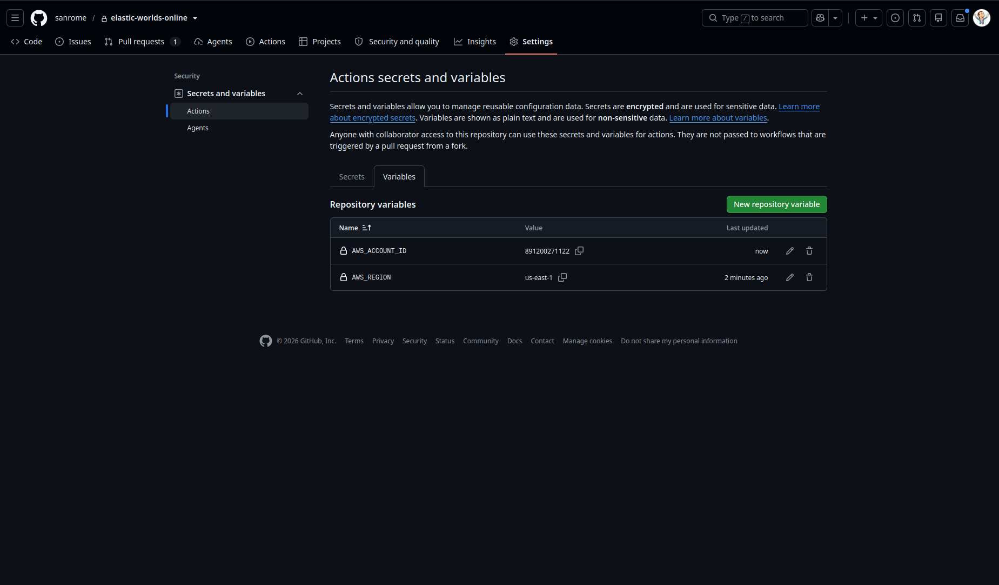
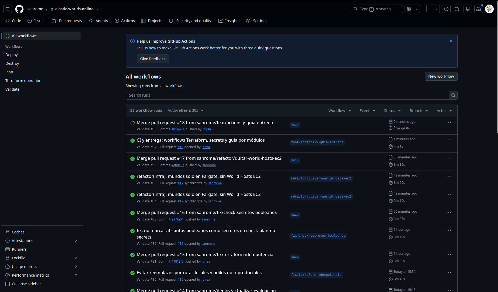
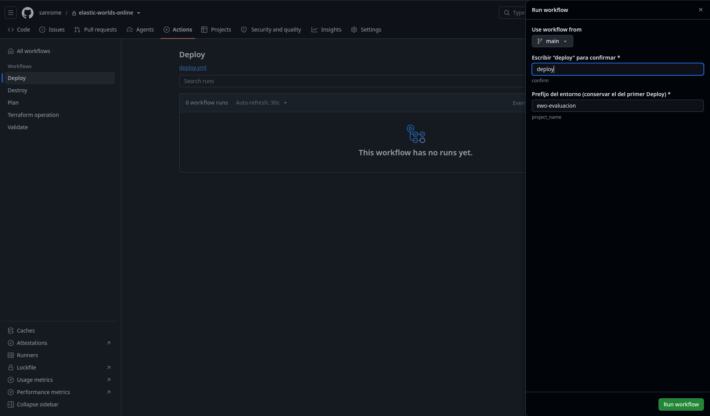
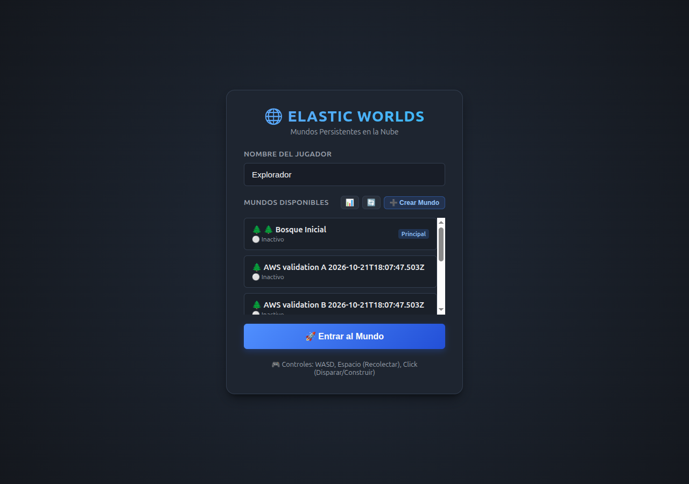
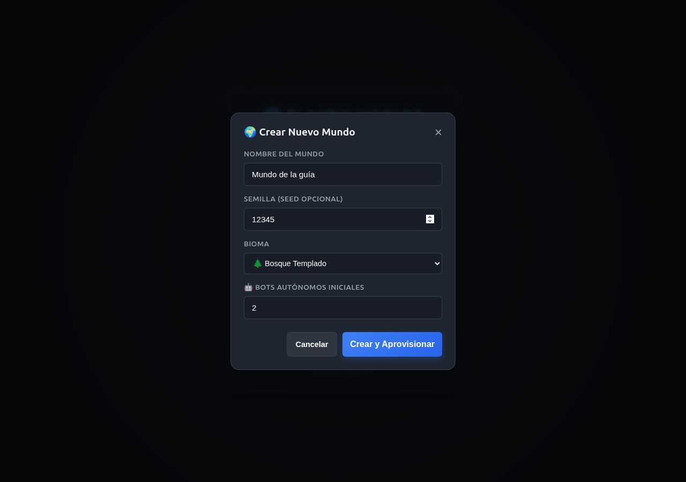
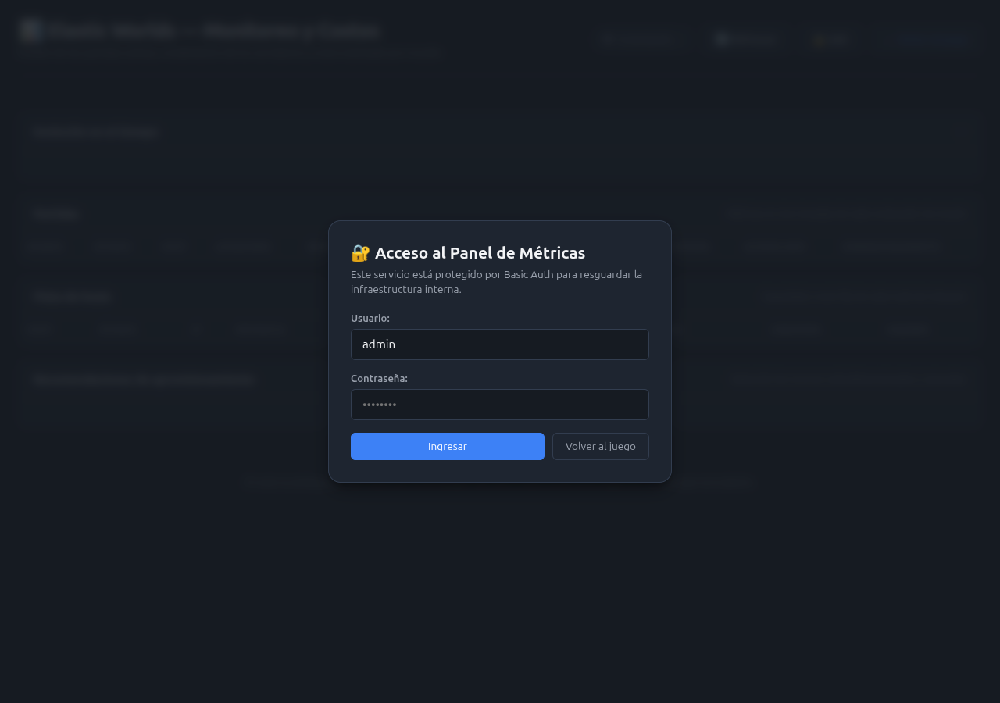

# Elastic Worlds Online — Infraestructura como Código

Infraestructura Terraform de un juego multijugador con mundos persistentes y
un panel de monitoreo. El módulo raíz está en [`infra/`](infra/), compone cinco
módulos propios y reutiliza módulos externos versionados.

**[Pasos para ejecutar desde GitHub Actions](#desplegar-en-aws)** ·
**[Módulos Terraform](#módulos-terraform)** ·
**[Funciones y metaargumentos](#funciones-y-metaargumentos-de-terraform)** ·
**[Guía de uso con capturas](#cómo-jugar-y-usar-el-monitoreo)**

La [demo del equipo](http://ewo-evaluacion-client-891200271122.s3-website-us-east-1.amazonaws.com/)
depende del Learner Lab activo. Para evaluar en otra cuenta, seguir los pasos
de Actions y usar los enlaces que publica ese despliegue.

## Desplegar en AWS

**El despliegue se opera desde GitHub Actions.** No hace falta instalar
Terraform, Docker ni AWS CLI en la computadora de quien evalúa. GitHub prepara
el backend, construye los artefactos y ejecuta Terraform.

### 1. Iniciar el Lab y obtener las credenciales

Iniciar el **Learner Lab de la cuenta que se va a evaluar**. Abrir
**AWS Details → AWS CLI → Show** y copiar los valores de `aws_access_key_id`,
`aws_secret_access_key` y `aws_session_token`. Los tres deben pertenecer a la
misma sesión activa.

Abrir la consola AWS del Lab y anotar el **ID de cuenta de 12 dígitos**, visible
en el menú de cuenta de la esquina superior derecha.

### 2. Configurar los secrets en GitHub

En el repositorio que se va a desplegar:

1. Abrir **Settings → Secrets and variables → Actions**.
2. En la pestaña **Secrets**, presionar **New repository secret**.
3. Crear cada fila de esta tabla: en **Name** va el nombre exacto y en
   **Secret**, únicamente el valor copiado del Lab, sin la línea `export`
   ni comillas. Guardar con **Add secret** y repetir para los otros dos.

| Name | Value: de dónde obtenerlo | Obligatorio |
| --- | --- | --- |
| `AWS_ACCESS_KEY_ID` | Valor de `aws_access_key_id` en AWS Details | Sí |
| `AWS_SECRET_ACCESS_KEY` | Valor de `aws_secret_access_key` de la misma sesión | Sí |
| `AWS_SESSION_TOKEN` | Valor de `aws_session_token` de la misma sesión, completo | Sí |

Al terminar, deben aparecer los tres nombres en **Repository secrets**:


En la misma página, abrir **Variables → New repository variable**:

| Name | Value | Obligatorio |
| --- | --- | --- |
| `AWS_ACCOUNT_ID` | Los 12 dígitos de la cuenta del Lab donde se quiere desplegar | Sí |
| `AWS_REGION` | Región de despliegue; si no se configura, se usa `us-east-1` | No |
| `AWS_STATE_BUCKET` | Solo para reutilizar un backend existente con otro nombre; normalmente dejar sin configurar | No |



El ID de cuenta de la captura corresponde al Lab del equipo; ingresar el de
la cuenta donde se va a desplegar, visible en el menú superior derecho de AWS.

**No hay que crear el bucket de estado a mano.** Deploy crea o verifica
`elastic-worlds-tfstate-<account-id>` con versionado, cifrado y bloqueo.
No se cargan `DB_PASSWORD` ni `METRICS_PASSWORD` en GitHub: esas contraseñas se
generan en Secrets Manager.

Cuando expire la sesión del Learner Lab, renovar **los tres secrets juntos**
en esta misma página con el botón de edición. No hace falta cambiar las variables
ni recrear la infraestructura. [Configuración detallada y errores frecuentes](.docs/github-actions.md).

### 3. Elegir el workflow

Los archivos de workflows deben estar integrados en la rama `main`.
En un fork, habilitar Actions desde la pestaña **Actions** si GitHub lo solicita.

Abrir **Actions** y elegir el workflow en la barra lateral:



| Workflow | Cómo se inicia | Qué hace |
| --- | --- | --- |
| **Validate** | Automático en PR/push a `main`, o manual con Run workflow | Tests del Lobby, scripts y Terraform con mocks; sin credenciales AWS |
| **Plan** | Actions → Plan → Run workflow → escribir `plan` | Comprueba el despliegue existente y calcula cambios; no ejecuta apply |
| **Deploy** | Actions → Deploy → Run workflow → escribir `deploy` | Prepara el backend, construye, valida, planifica y aplica ese mismo plan |
| **Destroy** | Actions → Destroy → Run workflow → escribir `destroy` | Aplica un plan de destrucción; conserva backend y buckets de datos/artefactos |

### 4. Ejecutar Deploy

1. Abrir **Actions → Deploy → Run workflow**.
2. En **Use workflow from**, elegir **`main`**.
3. En **confirm**, escribir **`deploy`**.
4. En **project_name**, mantener **`ewo-evaluacion`** para el primer entorno.
   Al actualizar, usar el mismo prefijo del primer Deploy.
5. Presionar **Run workflow**.
6. Abrir el run y esperar a que termine en verde.



El runner verifica la cuenta, prepara automáticamente el backend S3, construye
los ZIP/imágenes/JAR, inicializa y valida Terraform, controla que el plan no
introduzca IAM ni contraseñas persistidas, y aplica el plan guardado.
Una ejecución posterior reutiliza el mismo estado. Plan, Deploy y Destroy
comparten la misma exclusión para no escribir simultáneamente sobre el entorno.

### 5. Abrir el juego y el dashboard

En el run terminado, abrir **Summary** y buscar **Acceder a la aplicación**.
El resumen publica enlaces **Juego**, **Dashboard** y **API pública**, además
de cuenta, región, proyecto, commit y cantidad de cambios del plan.

Para entrar al Dashboard:

1. Abrir su enlace del resumen.
2. Usar el usuario **`admin`**.
3. Seguir el enlace **Secrets Manager** del mismo resumen y elegir
   **`<project_name>-metrics-password`**.
4. En **Secret value**, presionar **Retrieve secret value**.
5. Copiar la contraseña al formulario del dashboard y presionar **Ingresar**.

La contraseña se consulta en la consola de la cuenta AWS; no aparece en logs
ni en el resumen del workflow. El [recorrido con capturas](#cómo-jugar-y-usar-el-monitoreo)
muestra cómo crear un mundo, jugar y consultar las métricas.

Los workflows y su automatización están preparados en código. La prueba local
de su orquestación usa CLIs simuladas; todavía falta registrar un Deploy real
desde Actions de esta versión. La [evidencia AWS existente](.docs/evaluacion-activa.md)
corresponde al despliegue hecho desde terminal.

### 6. Jugar y consultar el monitoreo

Seguir el [recorrido completo con capturas](#cómo-jugar-y-usar-el-monitoreo)
de este README: abrir el juego, crear un mundo, entrar, usar los controles y
consultar el dashboard.

### 7. Retirar el entorno

**Actions → Destroy → Run workflow → main**. Escribir **`destroy`** y usar el
mismo **project_name** del Deploy.

Destroy conserva el bucket del backend y los buckets de aplicación con sus
snapshots/artefactos. No hay que borrar el estado para repetir Deploy.
Salir de una partida desconecta al jugador; no destruye RDS ni los
servicios compartidos.

## Cómo jugar y usar el monitoreo

Recorrido del juego y del panel de monitoreo con capturas de la aplicación
desplegada en AWS el **21/10/2026**. Los nombres y las cantidades de mundos,
jugadores y hosts pueden cambiar después de esa fecha.

Las capturas corresponden al entorno anterior con World Hosts EC2. El código
actual usa mundos en Fargate; la sección de hosts del dashboard puede diferir.
Estas imágenes documentan el recorrido de la interfaz, no un despliegue nuevo.

### 1. Abrir el juego

Después de **Actions → Deploy**, abrir el run terminado y entrar en
**Summary → Acceder a la aplicación → Juego**. Para probar la demo del equipo,
usar el enlace **Cliente** de [evaluación activa](.docs/evaluacion-activa.md).

El juego no pide una cuenta ni una contraseña. Escribir un nombre en
**Nombre del Jugador**; por ejemplo, `Explorador`. La lista de **Mundos
Disponibles** muestra los mundos existentes y su estado. El botón **🔄** permite
actualizarla y el botón **📊** abre el monitoreo.



Usar la dirección **HTTP del website de S3**, tal como la devuelve Terraform.
Abrir el HTML desde el endpoint HTTPS de objetos S3 puede bloquear la API HTTP
por contenido mixto. El entorno del equipo necesita que el Learner Lab esté
activo; sus URLs no son destinos permanentes para otros despliegues.

### 2. Crear un mundo

Para usar un mundo existente, pasar directamente al [paso 3](#3-entrar-al-mundo).
Para crear uno, presionar **➕ Crear Mundo** y completar el formulario:

| Campo | Qué ingresar |
| --- | --- |
| Nombre del Mundo | Un nombre reconocible; en el ejemplo, `Mundo de la guía` |
| Semilla | Opcional; `12345` permite repetir la generación del mapa |
| Bioma | Bosque Templado, Desierto Árido o Tundra Helada |
| Bots Autónomos Iniciales | Cantidad de NPC; el ejemplo usa `2` |



Presionar **Crear y Aprovisionar** una sola vez. Mientras se procesa, el botón
muestra **Creando…** y el formulario informa el avance. Al terminar, se cierra
y el mundo aparece seleccionado en la lista. Si todavía figura **Iniciando**,
esperar y refrescar la lista antes de volver a intentar.

### 3. Entrar al mundo

Seleccionar la tarjeta del mundo deseado y presionar **🚀 Entrar al Mundo**.
Si la tarjeta queda fuera de la vista, desplazar la lista de mundos. El borde
azul identifica la selección.


Un mundo **Inactivo** se inicia bajo demanda al intentar entrar. Es normal
que esa primera conexión tarde más que entrar a un mundo **Activo**. Cuando
termina, el lobby se reemplaza por el mapa y aparece el jugador.

### 4. Jugar y salir de la partida

La esquina superior izquierda muestra el nombre, la vida y el inventario. La
esquina superior derecha muestra la información del mundo, las coordenadas,
la cantidad de jugadores y el botón **Desconectar**. Los NPC también participan
de la partida.


| Control | Acción |
| --- | --- |
| `W`, `A`, `S`, `D` | Moverse |
| `Espacio` | Recolectar recursos cercanos |
| Click izquierdo | Disparar o construir con la selección activa |
| `1`, `2`, `3` | Seleccionar muro, fogata o torreta; el costo aparece en la barra |
| `F` | Consumir comida para recuperar vida, si hay disponible |
| `Enter` | Escribir/enviar un mensaje de chat |
| **Desconectar** | Salir de la partida y volver al lobby |

El chat comunica los mundos mediante Redis Pub/Sub. Para comprobar el modo
multijugador, otra persona puede abrir el mismo cliente, elegir otro nombre y
entrar al mismo mundo. Para probar el chat entre mundos, deben entrar a mundos
distintos y enviar un mensaje.

Desconectarse no elimina el mundo. El servicio guarda snapshots en S3 y puede
detener el runtime por inactividad. Volver a elegir el mismo mundo permite
iniciarlo otra vez. Usar el mismo nombre de jugador para recuperar sus datos
guardados; el nombre es la identidad del jugador en esta demo.

### 5. Acceder al panel de monitoreo

Desde el lobby, presionar **📊**, o abrir `dashboard.html` bajo la URL del
cliente. El panel solicita credenciales propias: **el nombre del jugador no
sirve para iniciar sesión en monitoreo**.



El usuario predeterminado es **`admin`** (`metrics_user` en Terraform).
Desde el **Summary** del Deploy, el operador abre **Secrets Manager**, elige
`<project_name>-metrics-password` en la región del despliegue y presiona
**Secret value → Retrieve secret value**. Copiar ese valor al formulario
del dashboard. No compartirlo en capturas, issues ni commits.
La [guía de Actions](.docs/github-actions.md#configurar-los-secrets-del-repositorio)
explica qué credenciales van en GitHub; la contraseña del dashboard se consulta
en AWS y no se carga como un secret de GitHub.

Quien solo necesita mirar el dashboard debe solicitar las credenciales al
operador; no necesita las claves de AWS. Completar **Usuario** y **Contraseña**,
y presionar **Ingresar**. Usar **Salir** al terminar; **Volver al juego** permite
regresar al cliente.

### 6. Leer las métricas de la partida

El indicador **En vivo · cada 5s** confirma que el panel recibe respuestas del
servicio. **Refrescar** permite pedir una actualización manual.


| Sección | Qué observar |
| --- | --- |
| Partidas activas | Cantidad de mundos activos respecto del total registrado |
| Jugadores conectados | Desglose de humanos y bots; al entrar debería aparecer el jugador |
| Memoria y game loop | Uso de memoria y frecuencia de actualización de la simulación |
| Latencia IA | Tiempo de decisión de los NPC |
| Evolución en el tiempo | Historial de jugadores, memoria, game loop, IA, mundos y costo |
| Partidas | Estado, host asignado y mediciones de cada mundo; la tabla tiene desplazamiento horizontal |

La telemetría atraviesa Kinesis, Flink y DynamoDB antes de llegar al panel.
Después de entrar o salir, esperar a las próximas muestras: refrescar el
dashboard no fuerza al pipeline a producir una medición nueva.

### 7. Consultar hosts y costos

Desplazar la página hacia abajo hasta **Flota de hosts** y
**Recomendaciones de aprovisionamiento**.


La tabla de hosts muestra estado, capacidad, ocupación y costo estimado de los
servidores. Las recomendaciones comparan el uso de los mundos con su capacidad
asignada. Son informativas: abrir el panel no cambia el tamaño de las instancias.

Los importes son **estimaciones del modelo de costos de la aplicación**, no
una factura de AWS ni el costo total de todos los servicios. Un mundo inactivo
libera su ejecución, pero la flota y los servicios compartidos pueden seguir
generando cargos.

## Módulos Terraform

El root conecta las entradas y salidas de estos módulos. Las tablas completas
de sus contratos y sus tests están en cada carpeta.

| Módulo propio | Instancia en el root | Composición |
| --- | --- | --- |
| [`network`](infra/modules/network/README.md) | `module.network` en [main.tf](infra/main.tf) | Base de red compartida |
| [`data`](infra/modules/data/README.md) | `module.data` en [main.tf](infra/main.tf) | Persistencia y caché |
| [`container-workload`](infra/modules/container-workload/README.md) | `module.npc`, `module.metrics` y `module.world_tasks` | Cómputo reutilizable de contenedores en Fargate |
| [`telemetry`](infra/modules/telemetry/README.md) | `module.telemetry` en [analytics.tf](infra/analytics.tf) | Ingesta, procesamiento y lectura de métricas |
| [`lobby`](infra/modules/lobby/README.md) | `module.lobby` en [lobby-serverless.tf](infra/lobby-serverless.tf) | API y ciclo de vida de los mundos |

### `infra/modules/network`

Encapsula la red: VPC, subredes por capa, tablas de rutas, NACLs y endpoints.
El root le pasa dos AZ y los CIDR de las capas pública, privada, base de datos y
caché. El módulo crea los SG de endpoints; las reglas y los SG de aplicación
se componen en el root.

- **Entradas principales:** `name`, `region`, `azs`, `vpc_cidr`,
  `subnet_cidrs` e `interface_endpoints`.
- **Salidas:** `vpc_id`, IDs de subredes por capa, IDs de tablas de rutas,
  `s3_prefix_list_id` y `endpoint_security_group_ids`.
- **Consumidores:** `data` recibe las subredes de datos/caché; `lobby`, `npc`
  y `metrics` reciben las privadas. Las tasks de mundos usan las públicas.
- **Módulo externo:** envuelve `terraform-aws-modules/vpc/aws` y su submódulo
  `vpc-endpoints`, ambos fijados en **5.21.0** en [main.tf](infra/modules/network/main.tf).

### `infra/modules/data`

Agrupa la base de datos y la caché con sus subnet groups. Recibe subredes y SG
ya creados; no define la red ni las reglas de acceso. El root habilita
`manage_master_user_password` y pasa `db_multi_az` a la entrada `multi_az`.

- **Entradas principales:** `name`, `subnet_ids`, `security_group_ids`,
  `username`, `manage_master_user_password`, `multi_az`,
  `cache_subnet_ids` y `cache_security_group_ids`.
- **Salidas:** `address`, `port`, `db_name`, `resource_id`,
  `master_user_secret_arn` y `redis_url`.
- **Consumidores:** el root conecta el endpoint y el ARN del secreto con Lobby
  y NPC, y la URL Redis con Lobby. `resource_id` permite que el módulo Lobby
  repita las migraciones cuando cambia la instancia de base de datos.
- **Módulos externos:** `terraform-aws-modules/rds/aws` **6.13.1** y
  `terraform-aws-modules/elasticache/aws` **1.11.2** en [main.tf](infra/modules/data/main.tf).

### `infra/modules/container-workload`

Evita duplicar la definición de un workload: cluster, logs, task definition,
repositorio/publicación de imagen opcionales, y servicio con autoscaling opcional.
`service = null` registra solo la task definition; con un objeto `service`
también mantiene las réplicas en ejecución.

- **Entradas principales:** nombre, CPU/memoria, puerto, `environment`, roles
  existentes, `image` o `push_image`, y el objeto `service` con red,
  capacidad y balanceador opcional.
- **Salidas:** `cluster_name`, `task_definition_arn`, `service_name`,
  `repository_url`, `log_group_name` y `autoscaling`.
- **Reutilización:** [npc-ecs.tf](infra/npc-ecs.tf) y
  [metrics-ecs.tf](infra/metrics-ecs.tf) instancian el mismo módulo con
  configuración diferente. [worlds-fargate.tf](infra/worlds-fargate.tf) lo usa
  para las tasks de mundos que el Lobby inicia y detiene en Fargate.
- **Dependencias:** recibe la red de `network`. El root pasa a NPC el contrato
  de `data`, y a Metrics la tabla de `telemetry`. El módulo no crea roles IAM.

### `infra/modules/telemetry`

Encapsula el stream de entrada, la tabla de resultados, la publicación del JAR
y la aplicación de procesamiento con sus logs. Recibe el bucket de artefactos
versionado desde el root; no lo crea ni administra el build del JAR.

- **Entradas principales:** `name`, `region`, `account_id`,
  `artifacts_bucket`, `flink_jar_path`, `flink_source_hash`,
  `service_role_arn` y `start_application`.
- **Salidas:** `stream_name`, `stream_arn`, `table_name` y `application_name`.
- **Consumidores:** el root configura los productores con el stream y entrega
  `table_name` a `module.metrics`.
- **Adaptación al Lab:** `create_stream_with_script` selecciona el bootstrap del
  stream mediante script cuando la API usada por el provider está restringida.
  El contrato de salidas es el mismo para ambos modos.

### `infra/modules/lobby`

Reúne las cinco funciones `public`, `internal`, `lifecycle`, `maintenance`
y `migrate`; los workflows `start`/`stop`; target groups y permisos de las
funciones HTTP; y el mantenimiento programado con sus alarmas.
Las migraciones se ejecutan antes de habilitar las funciones que las necesitan.

- **Entradas principales:** `lambda_zips`, `workflows_dir`, `migrations_dir`,
  `subnet_ids`, `security_group_ids`, roles existentes, `environment`,
  `database_resource_id` y opciones de mantenimiento.
- **Salidas:** `target_group_arns`, `workflows`, `function_names`,
  `maintenance_alias_arn` y `maintenance_schedule`.
- **Dependencias:** el root arma `environment` con los contratos de
  `data`, `telemetry`, snapshots y launcher. El módulo recibe las subredes
  privadas de `network`.
- **Consumidores:** [load-balancer.tf](infra/load-balancer.tf) conecta
  `target_group_arns["public"]` y `["internal"]` con los listeners.
  Los nombres de funciones y workflows también se exponen como outputs del root.

### Composición del módulo raíz

[`infra/`](infra/) ensambla los módulos y conserva los recursos que los conectan:
SG y reglas compartidas, listeners, publicación del cliente, snapshots, secretos,
bootstrap de artefactos y configuración de las tasks de mundos. Esos recursos están en
[security.tf](infra/security.tf), [load-balancer.tf](infra/load-balancer.tf),
[storage.tf](infra/storage.tf), [secrets.tf](infra/secrets.tf),
[bootstrap.tf](infra/bootstrap.tf) y [worlds-fargate.tf](infra/worlds-fargate.tf).

Los módulos externos tienen su versión fijada en cada bloque `module`.
Los providers se fijan por separado mediante
[`.terraform.lock.hcl`](infra/.terraform.lock.hcl): un provider no es un
módulo externo.

## Funciones y metaargumentos de Terraform

### Funciones utilizadas

| Función | Para qué se usa | Referencia real |
| --- | --- | --- |
| `cidrsubnet()` | Derivar los CIDR de cada capa a partir de `vpc_cidr` | [main.tf](infra/main.tf) |
| `slice()` | Elegir las dos primeras AZ disponibles que recibe `network` | [main.tf](infra/main.tf) |
| `templatefile()` | Completar las definiciones de Step Functions con las funciones de cada operación | [lobby/main.tf](infra/modules/lobby/main.tf) |
| `join()` | Pasar los IDs de subredes al launcher como una cadena separada por comas | [worlds-fargate.tf](infra/worlds-fargate.tf) |
| `jsonencode()` | Generar `runtime-config.js` con las URLs del entorno | [storage.tf](infra/storage.tf) |
| `merge()` | Combinar la configuración común del Lobby con la del launcher | [lobby-serverless.tf](infra/lobby-serverless.tf) |
| `toset()` | Obtener nombres estables para iterar funciones y workflows | [lobby/main.tf](infra/modules/lobby/main.tf) |
| `filebase64sha256()` | Detectar cambios en el ZIP de cada función | [lobby/main.tf](infra/modules/lobby/main.tf) |

### Metaargumentos utilizados

| Metaargumento | Aplicación y efecto | Referencia real |
| --- | --- | --- |
| `for_each` | Crea funciones/target groups de las APIs pública e interna con claves estables | [lobby/main.tf](infra/modules/lobby/main.tf) |
| `count` | Activa o desactiva los recursos del bootstrap según `bootstrap_from_source` | [bootstrap.tf](infra/bootstrap.tf) |
| `depends_on` | Espera las reglas de acceso a DB/secretos antes de migrar desde Lobby; referenciar un SG no implica esperar sus reglas | [lobby-serverless.tf](infra/lobby-serverless.tf) |
| `lifecycle` con `ignore_changes` | Delega `desired_count` al autoscaling para que Terraform no restablezca la capacidad inicial | [container-workload/main.tf](infra/modules/container-workload/main.tf) |

Se documentan ocho funciones y los cuatro metaargumentos de la lista de la consigna;
las referencias muestran usos efectivos del proyecto.

## Variables y outputs

Actions carga la configuración reproducible de [`evaluacion.tfvars.example`](infra/environments/evaluacion.tfvars.example).

| Variable | Uso en la evaluación |
| --- | --- |
| `aws_region`, `project_name` | Región `us-east-1` y prefijo `ewo-evaluacion` en el ejemplo; conservarlos al actualizar |
| `vpc_cidr` | Rango de la VPC; las ocho subredes se distribuyen en dos AZ |
| `bootstrap_from_source` | Construir imágenes, ZIP y JAR desde este checkout; `true` |
| `world_task_image`, `world_task_cpu`, `world_task_memory` | Imagen y recursos de cada task de mundo en Fargate |
| `db_multi_az` | Standby RDS; habilitado por defecto |
| `npc_*`, `metrics_*` | Capacidad de los servicios NPC y Metrics |
| `start_telemetry_application` | Iniciar Flink; `true` para comprobar la telemetría completa |
| `metrics_user`, `metrics_password_version` | Usuario del panel y versión para regenerar su contraseña |
| `cleanup_bootstrap_buckets` | Conservación de buckets al destruir; `false` por defecto |

| Output | Uso |
| --- | --- |
| `client_website_url`, `alb_url` | Cliente y API; dashboard en `/dashboard.html` del cliente |
| `network`, `rds_endpoint`, `internal_alb_url` | Red y destinos privados; no son accesos desde Internet |
| `db_secret_arn`, `metrics_password_secret_arn` | Referencias a los secretos, sin exponer contraseñas |
| `snapshot_bucket_name`, `flink_application_name` | Snapshots y aplicación de telemetría |
| `telemetry_stream_name`, `telemetry_table_name` | Stream de entrada y tabla de métricas agregadas |
| `metrics_service`, `world_tasks` | Identificación del servicio Metrics y la definición de tasks de mundos |

## Mapa del repositorio

```text
.
├── client/                    # Juego web y dashboard
├── lobby-service/             # API, operaciones y funciones Lambda
├── world-service/             # Simulación, WebSocket y snapshots
├── npc-service/               # NPC y coordinación por leases
├── metrics-service/           # Telemetría y modelo de costos
├── flink-metrics-job/          # Agregación de eventos
├── infra/                     # Composición Terraform, variables y outputs
│   ├── modules/               # Cinco módulos propios
│   ├── environments/          # Ejemplo para evaluación
│   ├── tests/                 # Tests con providers mockeados
│   └── probes/                # Pruebas aisladas de permisos/estado
├── scripts/                   # Bootstrap, validación y operación
├── .github/workflows/         # CI y deploy manual
└── .docs/                     # Guías, decisiones y evidencias
    ├── capturas/              # Screenshots reales del despliegue
    ├── arquitectura/          # Diagramas de red y flujos
    └── entrega-3/             # Requisitos, tareas y registros de revisión
```

La [guía local](howtorun.md) sirve para desarrollar los servicios fuera de AWS.
Para operar la nube, usar este README y [evaluación activa](.docs/evaluacion-activa.md).
Los planes y auditorías conservan fechas y commits: describen lo revisado
en cada registro.

## Validación y documentación complementaria

**Validate** ejecuta los tests del Lobby con PostgreSQL descartable, los tests
de empaquetado Lambda, los tests Python y los tests de Terraform con mocks.
La automatización de Plan/Deploy/Destroy se prueba con CLIs simuladas, sin AWS.